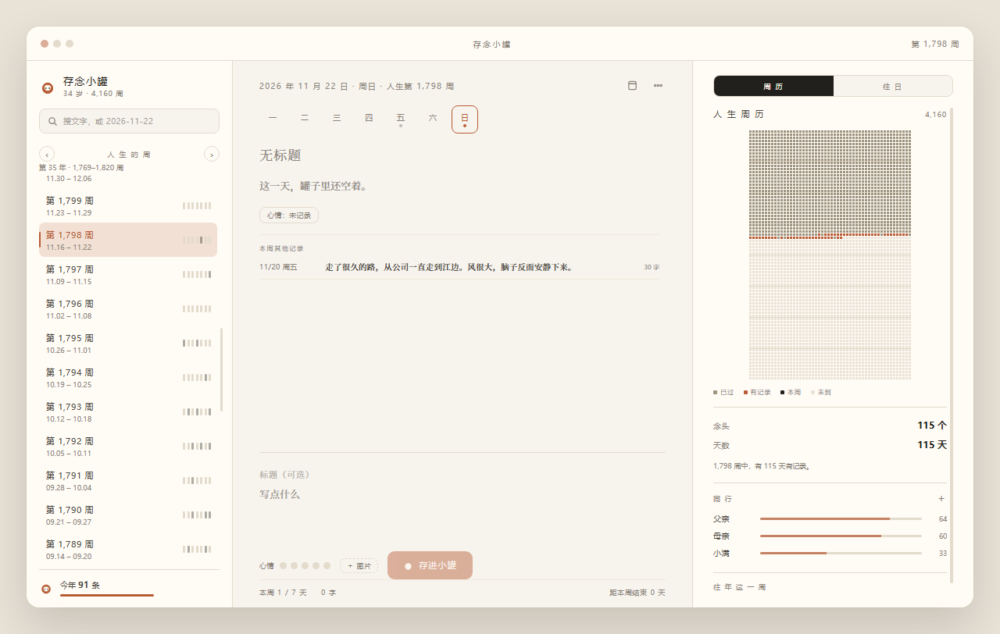

# 存念小罐

> 一周存一点，留给未来的自己。

一个本地优先的「人生周历」笔记本。把一生画成 4,160 个格子（80 年 × 52 周），一周一格，想写就写一句。

没有账号、没有服务器、没有网络请求。数据用你的密码加密，只存在这台设备上。



## 下载

Windows 免安装版：[Releases](https://github.com/JackyBo11/JackyBo-box/releases) → CunNianJar-win-x64-v1.0.zip

解压后双击 CunNianJar.exe。未做代码签名，首次运行如被 SmartScreen 拦，点「更多信息 → 仍要运行」。
## 它是什么

- **人生周历**：4,160 个点，走过的是灰的，写过的那周是陶土色
- **每天一条**：一句也行，一段也行，一天最多 10 张图
- **心情**：五个圆点，点一下就好，不用写字
- **往日**：按日期倒序回看写过的日子，点一下跳过去
- **同行**：最多五个人，只看进度，看不到内容
- **四套皮肤**：纸白 / 雾青 / 靛蓝 / 夜窗

## 它刻意不做的事

| 不做 | 为什么 |
|---|---|
| 云端同步 | 数据一旦上云，就不再只属于你 |
| 分享到社交 | 这是给自己看的，不是给别人看的 |
| 连续打卡 / 成就 | 断更不该有负罪感 |
| 密码找回 | 密码就是密钥，找不回是加密的代价 |
| 显示「还剩多少年」 | 提醒珍惜时间，不等于每天报一次倒计时 |

## 安全模型

```
密码 ──PBKDF2-SHA256(200,000 次)──▶ AES-256-GCM 密钥 ──▶ 加密后写进浏览器本地存储
```

- 密码不落盘，输错就打不开
- 本机存储里只有密文，用文本编辑器打开是乱码
- 多账户：一台设备可以有多个账户，各自独立的密钥和密文
- 跨设备同步靠「罐子码」：16 位码派生密钥，给导出的文件加密

**代价说清楚**：密码丢了，数据就永久打不开，没有后门。

## 跑起来

### 只用原型（最简单）

双击 `原型.html`，用浏览器打开。一个文件，零依赖，所有功能都在。

### 桌面版（Windows）

```bash
cd desktop
pnpm install
pnpm start        # 开发运行
pnpm run pack     # 打包成 exe
```

打包产物在 `desktop/dist/`，整个文件夹一起拷贝，双击 `存念小罐.exe`。

数据位置：`%APPDATA%\CunNianJar\`，删掉这个文件夹等于恢复出厂。

### macOS

代码已经做了平台分支（用系统红绿灯、`hiddenInset` 标题栏），但**需要在 Mac 上打包**：

```bash
cd desktop
pnpm install
pnpm start
pnpm run pack:mac
```

未签名的 `.app` 首次打开需要右键 → 打开。

## 快捷键与操作

| 操作 | 效果 |
|---|---|
| 双击标题栏 | 最大化 / 还原 |
| F11 | 最大化 / 还原 |
| Esc | 关闭大图 / 弹层 |
| 点右上角圆点 | 关闭 / 最小化 / 最大化 |

## 目录

```
desktop/           Electron 外壳 + 应用本体
   main.js         主进程：无边框窗口、app:// 协议、窗口按钮
   preload.js      只暴露三个窗口方法
   renderer/       应用（单文件 HTML，零依赖）
   build/          应用图标
原型.html           浏览器版，功能与桌面版一致
docs/              产品需求文档与截图
```

## 已知限制

- 扫码配对在桌面版不可用（Electron 不带 `BarcodeDetector`），手工输 16 位罐子码即可
- 移动端尚未适配
- 无边框窗口的圆角在 100% 缩放的屏幕上会有轻微锯齿，这是 1 倍像素密度下 Chromium 的渲染上限

## 许可

保留所有权利。如需引用或二次分发，请先联系作者。
